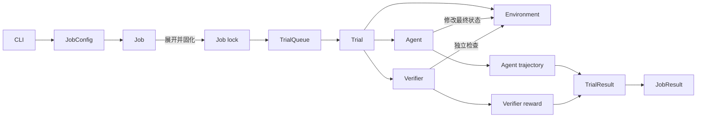

# Mini Harbor Framework

一个用于学习 Agent Evaluation Harness 的最小闭环实现。

项目从 Harbor 的完整架构中保留最核心的数据流和生命周期：把用户配置确定化为 Trial，调度 Agent 修改隔离工作区，再由独立 Verifier 检查最终状态，最后持久化 TrialResult 并聚合 JobResult。

它不是 Harbor 的替代品，也不包含真正的大模型推理、Docker 安全隔离或远程数据集；它的目标是用少量、带中文注释的 Python 代码解释 Harbor 为什么这样设计。

## 核心链路



一条最重要的评价语义是：

> Agent 进程结束，不等于任务正确；Verifier 通过，也不一定代表 Trial 没有过程异常。最终结论必须同时查看轨迹、评分、异常和聚合结果。

## 保留了哪些 Harbor 核心概念

| 核心部件 | 在 Mini Harbor 中的职责 |
|---|---|
| CLI | 把命令行参数转换成 JobConfig |
| Task | 提供 instruction、初始环境和评分规则 |
| JobConfig | 保存用户实验意图 |
| Job lock | 把 Task × Attempt 展开成确定的 Trial 清单 |
| Job | 创建 Trial、启动队列、聚合结果 |
| TrialQueue | 控制最大并发数，并按异常策略执行指数退避重试 |
| Trial | 编排环境准备、Agent、Verifier、清理和结果落盘 |
| Agent | 根据 instruction 修改 Environment |
| Environment | 为每个 Trial 提供独立工作目录 |
| Verifier | 独立检查最终环境状态并产生 reward |
| TrialResult | 保存单次实验的轨迹摘要、评分、异常和阶段时间 |
| JobResult | 汇总完成数、异常数、重试数、平均奖励和成功率 |

## 明确没有实现的能力

- Docker、Podman、Kubernetes 或云端环境
- 大模型 API、工具调用循环和多步 Agent
- 数据集注册表、远程任务下载和上传
- MCP、Skills、Sidecar 和网络策略
- Viewer、Hub、Resume、Regrade 和 pass@k
- 面向不可信代码的安全沙箱

`LocalWorkspaceEnvironment` 只提供教学意义上的工作目录隔离和路径逃逸检查，不能安全运行不可信命令。

## 项目结构

```text
mini-harbor-framework/
├── src/mini_harbor/
│   ├── cli.py              # CLI：接收用户参数
│   ├── models.py           # Config、TrialResult、JobResult 等数据模型
│   ├── task.py             # 加载并校验 Task
│   ├── job.py              # Trial 确定化与 Job 聚合
│   ├── queue.py            # 并发控制和失败重试
│   ├── trial.py            # 单个 Trial 的完整生命周期
│   ├── agents.py           # Agent 接口与确定性规则 Agent
│   ├── environment.py      # Environment 接口与本地工作区实现
│   ├── verifier.py         # Verifier 接口与文件断言评分器
│   └── serialization.py    # JSON 和 JSONL 持久化
├── examples/tasks/
│   └── write-greeting/     # 可运行的非 Oracle Demo Task
├── experiments/
│   └── 2026-09-22-write-greeting.md
├── tests/
│   └── test_framework.py
└── pyproject.toml
```

## 快速开始

要求 Python 3.11 或更高版本，不依赖第三方运行时库。

### 1. 创建环境并安装

Windows PowerShell：

```powershell
py -3.11 -m venv .venv
.\.venv\Scripts\Activate.ps1
python -m pip install -e .
```

macOS 或 Linux：

```bash
python3 -m venv .venv
source .venv/bin/activate
python -m pip install -e .
```

### 2. 运行完整 Demo

```powershell
mini-harbor run `
  --path ".\examples\tasks\write-greeting" `
  --agent rule-based-file-agent `
  --n-attempts 2 `
  --n-concurrent 2 `
  --max-retries 1 `
  --keep-workspace
```

预期摘要：

```text
Trials: 2/2 | Exceptions: 0 | Mean: 1.000 | Success rate: 100.0%
```

已经完成的真实运行、事件链和结果解释见 [Step 3 实验记录](experiments/2026-09-22-write-greeting.md)。

## Demo Task 怎样工作

Task 目录包含三个输入：

```text
write-greeting/
├── instruction.md       # Agent 收到的任务指令
├── task.toml            # 任务名、超时和评分规则
└── environment/
    └── context.txt      # Trial 的初始环境状态
```

教学 Agent 只理解一个极小协议：

```text
WRITE_FILE greeting.txt
Hello from Mini Harbor!
```

Agent 执行后，Verifier 不读取 Agent 的“自我报告”，而是直接检查 Environment 中的 `greeting.txt`。这体现了 Evaluation Harness 的核心原则：按可验证的最终状态评分。

## 实验产物

每次运行都会生成一个 Job 目录：

```text
jobs/<timestamp>/
├── config.json                 # 用户请求的实验配置
├── lock.json                   # 已确定化的 Trial 清单
├── job.log                     # Job 生命周期事件
├── result.json                 # Job 聚合结果
└── <trial-name>/
    ├── config.json             # 当前 Trial 配置
    ├── lock.json               # Task 摘要、Agent 和 attempt
    ├── trial.log               # Trial 生命周期事件
    ├── result.json             # Trial 最终结果
    ├── agent/
    │   └── trajectory.json     # Agent 动作轨迹
    ├── verifier/
    │   ├── test-stdout.txt     # Verifier 原始判断
    │   └── reward.json         # 原始 reward
    └── workspace/              # 仅使用 --keep-workspace 时保留
```

这些文件分别回答不同问题：

- `config.json`：用户原本想运行什么？
- `lock.json`：系统最终决定运行哪些 Trial？
- `trajectory.json`：Agent 实际做了什么？
- `reward.json`：Verifier 给出了什么原始分数？
- Trial `result.json`：这次执行是否有异常，最终得分是多少？
- Job `result.json`：整个实验的总体表现如何？

## 推荐源码阅读顺序

1. `models.py`：先理解 Config、TrialResult 和 JobResult 的边界。
2. `cli.py`：观察用户参数怎样进入 JobConfig。
3. `job.py`：理解 JobConfig 怎样展开成 lock 中确定的 Trial。
4. `queue.py`：理解并发许可、异常过滤和指数退避重试。
5. `trial.py`：串起 Environment、Agent、Verifier 和清理逻辑。
6. `agents.py`、`environment.py`、`verifier.py`：理解三个可替换接口。
7. `tests/test_framework.py`：从成功、异常、重试和安全边界反向验证设计。

## 运行测试

```powershell
python -m unittest discover -s tests -v
```

当前测试覆盖：

- 成功 Trial 的完整证据落盘
- 多 attempt 展开和 Job 聚合
- Agent 异常记录后继续运行 Verifier
- 异常白名单驱动的重试
- `retry_count` 的内存与磁盘一致性
- 本地 Environment 的路径逃逸拦截

## 可以怎样继续扩展

三个核心接口已经分离，可以沿着 Harbor 的方向逐步扩展：

- 新增真实 LLM Agent，但保持 Trial 不感知模型供应商；
- 新增 DockerEnvironment，但保持 Agent 和 Verifier 面向统一接口；
- 新增脚本或测试框架 Verifier，而不修改调度层；
- 把 Agent 并发上限与全局 Trial 并发上限分开；
- 增加超时失败、错误重试和部分得分 Demo；
- 增加 Viewer，对现有 JSON 证据做只读展示。

扩展时应继续保持这条边界：Agent 负责产生状态，Verifier 负责判断状态，Harness 负责可靠地编排并保存证据。
