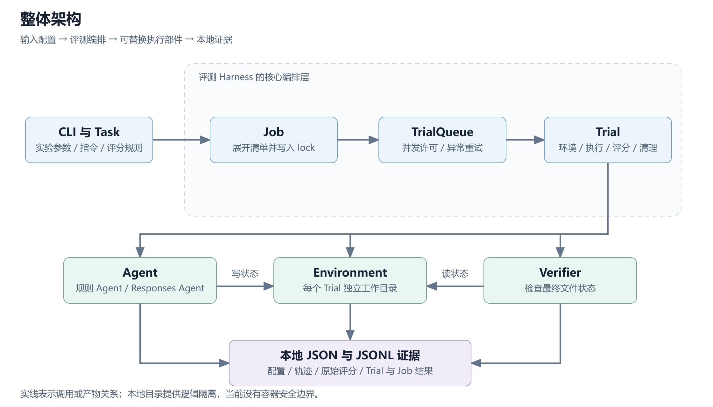
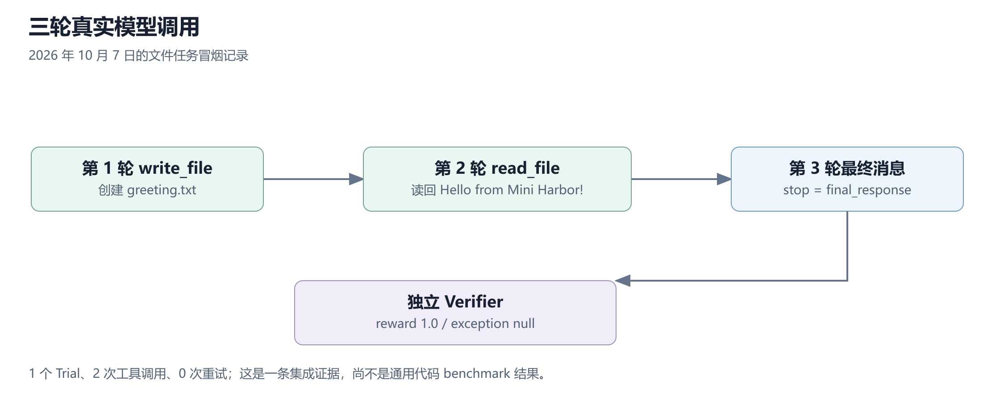

# Mini Harbor

一个参考 Harbor 核心流程、使用 Python 标准库实现的轻量级 **Agent 评测 Harness**。项目将任务配置展开为独立 Trial，统一管理环境准备、Agent 执行、独立评分、异常处理与结果聚合，便于理解一次 Agent 运行如何成为可追溯的评测记录。

当前已完成文件任务闭环、规则 Agent 与真实 Responses API Agent，并用 IQuest-Q1 跑通一次真实模型冒烟测试。**当前验证范围是本地文件任务；HumanEval、mini-harness Agent 适配和容器评分尚未接入。**

- [项目总结与 24 个面试 QA](summary-note/mini-harbor-summary.md)
- [下载 Word 总结](summary-note/mini-harbor-summary.docx)
- [规则 Agent 实验记录](experiments/2026-09-22-write-greeting.md) · [IQuest-Q1 真实冒烟记录](experiments/2026-10-07-iquest-q1-smoke.md)

## 架构与职责



```text
CLI → JobConfig → Job → TrialQueue → Trial
                      │                ├── Environment：准备与承载工作区
                      └── lock.json    ├── Agent：执行任务并产生状态
                                       └── Verifier：独立检查最终状态
                                              ↓
                                      TrialResult → JobResult
```

| 部分 | 职责与策略 |
|---|---|
| Task | 加载指令、初始文件和评分配置；校验输入，计算内容摘要 |
| JobConfig / TrialConfig | 分开保存用户实验意图与已展开的执行配置 |
| Job | 将 Task × Attempt 展开为 Trial，写入计划并聚合结果 |
| TrialQueue | 用 `asyncio.Semaphore` 限制并发；按异常过滤策略指数退避重试 |
| Trial | 编排准备、执行、评分与清理；分别记录阶段时间和过程异常 |
| Agent | 通过统一接口接入规则 Agent 或 Responses 文件 Agent |
| Environment | 为每个 Trial 建立独立目录，复制初始状态并检查文件路径 |
| Verifier | 直接检查最终文件，输出原始判断与 reward |
| 持久化 | JSON 保存配置与结果快照，JSONL 追加生命周期事件 |

项目使用 `dataclass`、ABC、`asyncio`、`urllib`、JSON 与 `unittest`，没有第三方运行时依赖。

## 评测语义

**最终任务正确性与执行过程异常分别记录。** Agent 返回“完成”不是评分依据；最终文件正确，也可能同时存在 API 或执行异常。

| 最终评分 | 过程异常 | 解释 |
|---|---|---|
| reward = 1 | 无 | 最终状态通过，过程没有记录到异常 |
| reward = 0 | 无 | 执行正常返回，但任务未通过 |
| reward = 1 | 有 | 最终状态正确，执行过程仍有异常 |
| reward = 0 或缺失 | 有 | 需进一步区分 Agent、环境与评分阶段的错误 |

- Agent 阶段报错或超时后，仍尝试评分已有最终状态；环境准备失败则进入异常处理与清理。
- `n_attempts` 是独立 Trial 数的展开因子；`max_retries` 是同一 Trial 过程异常后的重试上限。错误答案本身不会触发重试。
- `success_rate` 按 `reward >= 1` 计算；`n_completed_trials` 是返回 TrialResult 的数量，不能当作正确数或无异常完成数。
- 缺失 reward 按 0 计入总体均值，异常数另行报告，避免异常样本从分母中消失。

## 快速运行

要求 **Python 3.11+**，以下命令均在项目根目录执行。文件 Demo 不需要 Docker、模型 key 或依赖安装。

### 1. 规则 Agent Demo

Windows PowerShell：

```powershell
$env:PYTHONPATH = (Join-Path $PWD 'src')
py -3.13 -X utf8 -m mini_harbor run `
  --path examples/tasks/write-greeting `
  --agent rule-based-file-agent `
  --n-attempts 2 `
  --n-concurrent 2 `
  --max-retries 1 `
  --keep-workspace
```

`py -3.13` 可以替换为本机的 Python 3.11+ 解释器。macOS / Linux：

```bash
PYTHONPATH=src python3 -m mini_harbor run \
  --path examples/tasks/write-greeting \
  --agent rule-based-file-agent \
  --n-attempts 2 --n-concurrent 2 --max-retries 1 --keep-workspace
```

预期摘要：

```text
Trials: 2/2 | Exceptions: 0 | Mean: 1.000 | Success rate: 100.0%
```

规则 Agent 按 `WRITE_FILE <相对路径>` 加正文的协议写文件；Verifier 独立检查 `greeting.txt` 的内容。此任务没有异常时，不会实际触发重试。

如需安装命令行入口，可在自己的虚拟环境中执行 `python -m pip install -e .`，随后使用 `mini-harbor run ...`。

### 2. 真实模型冒烟测试

先复制配置模板；已有 `.env` 时保留本地配置：

```powershell
if (-not (Test-Path .env)) { Copy-Item .env.example .env }
```

在本地 `.env` 填写 `OPENAI_API_KEY`，其余配置示例为：

```dotenv
OPENAI_API_KEY=
OPENAI_BASE_URL=https://codeplan.iquestlab.com/api/predict/converge.converge/v1
MODEL_NAME=IQuest-Q1
OPENAI_API_MODE=responses
```

下面的命令会调用所配置的真实模型 API：

```powershell
$env:PYTHONPATH = (Join-Path $PWD 'src')
py -3.13 -X utf8 -m mini_harbor run `
  --path examples/tasks/llm-write-greeting `
  --agent responses-file-agent `
  --n-attempts 1 --n-concurrent 1 --max-retries 0 --keep-workspace
```

Responses Agent 只提供 `read_file` 和 `write_file`，最多请求 4 轮；底层 HTTP 操作超时参数为 45 秒，示例 Task 的 Agent 阶段超时为 180 秒。非空进程环境变量优先于 `.env`。未显式设置采样参数或 token 总预算，因此不能将该配置称为 greedy 解码或严格费用封顶。

`.env` 被 Git 忽略，`.env.example` 不包含真实凭据。轨迹对模型返回内容和工具结果做精确 key 替换，HTTP 错误不保存 Authorization header 或响应正文；这不是通用敏感信息检测器。

### 3. 离线回归测试

```powershell
py -3.13 -X utf8 -m unittest discover -s tests -v
```

8 项测试覆盖：成功证据落盘、多 attempt 聚合、Agent 异常后评分、异常白名单重试、路径越界、工具结果回传，以及 API 失败后的部分轨迹保存。模型相关测试使用 mock，不调用外部 API。

## 已验证的结果

| 验证 | 结果 | 证据边界 |
|---|---|---|
| 离线回归 | 8 项测试通过 | 验证所覆盖的控制逻辑，不能代替真实模型评测 |
| 规则 Agent Demo | 2/2 Trial，reward 均为 1，无异常 | 确定性文件任务的评测闭环 |
| IQuest-Q1 真实冒烟 | 1/1 Trial，3 轮请求、2 次工具调用，reward 1，无异常、无重试 | 单个文件任务集成验证，不是通用代码 benchmark 分数 |



真实模型记录来自 **2026-10-07**，离线测试于 **2026-10-20** 重新核验。原始 Job 位于被忽略的本地 `jobs/` 目录；仓库保留对应实验记录，克隆仓库不会自动包含原始现场。

## 项目结构与代码规模

```text
mini-harbor-framework/
├── src/mini_harbor/
│   ├── cli.py               CLI 与 Job 入口
│   ├── models.py            配置、结果、异常与阶段时间
│   ├── task.py              Task 加载、校验与摘要
│   ├── job.py               Trial 展开与 Job 聚合
│   ├── queue.py             并发许可、异常过滤与重试
│   ├── trial.py             单次评测生命周期
│   ├── agents.py            Agent 接口、规则 Agent 与工厂
│   ├── llm_agent.py         Responses 文件工具循环
│   ├── environment.py       环境接口与本地目录实现
│   ├── verifier.py          独立文件断言评分
│   └── serialization.py     JSON / JSONL 持久化
├── tests/                   2 个文件，8 项测试
├── examples/tasks/
│   ├── write-greeting/      规则 Agent 任务
│   └── llm-write-greeting/  真实模型任务
├── experiments/             规则与真实模型实验记录
├── summary-note/            Markdown、Word 总结与 SVG / PNG 配图
├── .env.example             可提交的空 key 配置模板
├── .gitignore
├── .gitattributes
└── pyproject.toml
```

截至 2026-10-20，`src/` 下 13 个 Python 文件共 **1,217 行**，`tests/` 下 2 个文件共 **266 行**，合计 **1,483 个物理行、1,215 个非空行**。物理行包括空行、注释和文档字符串，不统计运行产物或文档构建脚本。逐文件统计见[项目总结](summary-note/mini-harbor-summary.md#代码量统计口径)。

推荐源码顺序：`models.py` → `task.py` → `cli.py` → `job.py` → `queue.py` → `trial.py` → Agent / Environment / Verifier → 测试。

## 运行产物

```text
jobs/<timestamp>/
├── config.json / lock.json / job.log / result.json
└── <trial-name>/
    ├── config.json / lock.json / trial.log / result.json
    ├── agent/trajectory.json
    ├── verifier/reward.json
    ├── verifier/test-stdout.txt
    └── workspace/            仅 --keep-workspace 时保留
```

`config` 保存实验配置，`lock` 保存展开清单或任务身份，`trajectory` 保存 Agent 动作，Verifier 文件提供原始评分，Trial / Job 结果记录过程异常与聚合。失败时尽力保留已发生的模型动作，但当前轨迹不是逐步刷盘，进程崩溃时仍可能丢失。

`jobs/`、本地凭据、历史临时目录、自动生成的工具配置和文档渲染中间产物不提交到 Git。`summary-note/` 保留可直接阅读的 Markdown、Word 和配图；`_build/code-statistics.json` 是总结的源码统计快照，其余 `_build/` 内容仅供本地制作和排版检查。

## 当前限制与下一步

| 当前边界 | 后续方向 |
|---|---|
| 本地目录与路径检查不是安全沙箱；模型没有命令执行工具 | 容器执行环境与明确的权限、网络和挂载边界 |
| Verifier 只检查文件文本，含结尾换行约定 | 测试型 Verifier，区分答案错误与评分基础设施错误 |
| Semaphore 在退避期间仍占许可；没有模型请求级限流 | 完善调度与 API 错误分类 |
| 重试会删除前次 Trial 目录，只留最后一次现场 | 每次重试单独归档证据 |
| Task 摘要和 lock 不保证严格冻结；写 JSON 非原子操作 | 不可变输入快照、版本 manifest、原子落盘与恢复 |
| success_rate 只看 reward，CLI 在 Job 返回后退出 0 | 增加正常完成率与更明确的退出码语义 |

已讨论的 benchmark 路线是：**mini-harbor 编排 → mini-harness Agent 调用真实模型 → HumanEval 前 5 题 → 独立容器评分**。这是后续计划，目前没有接入模块或评测成绩。Resume、Regrade、pass@k、Viewer 与分布式调度也尚未实现。
