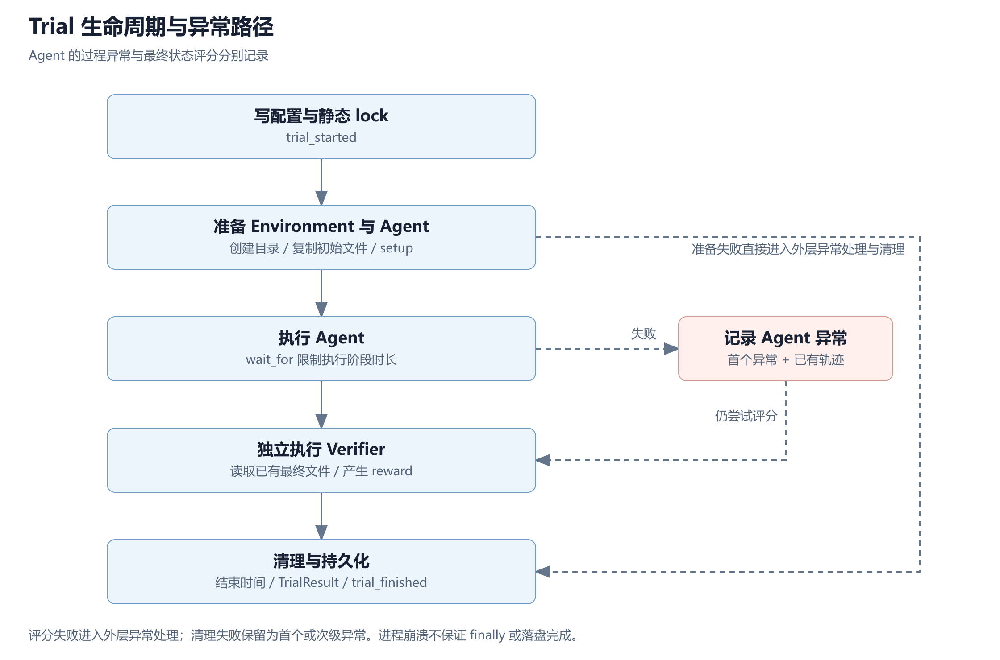

# Mini Harbor 项目总结与面试准备

基于当前工作区源码与本地实验产物核对　2026 年 10 月 20 日

## 01 项目定位与阅读路线

Mini Harbor 是一个参考 Harbor 核心流程的轻量级 Agent 评测 Harness。它把一次评测拆为配置、确定的 Trial 清单、执行环境、Agent、独立 Verifier 和结果聚合，解决“怎样把 Agent 的一次运行变成可解释、可追溯的评测记录”这个问题。

已实现的主线是文件任务评测，已接入 IQuest-Q1 完成一次真实模型冒烟验证。当前没有 DockerEnvironment、测试型 Verifier、HumanEval 任务适配器或 mini-harness Agent 适配器。后文分别标注现有实现、实验证据与规划，避免把计划当成果。


图 1　先看上方编排链，再看下方三个部件。Agent 产生状态，Environment 承载状态，Verifier 判断状态，Trial 串起生命周期，Job 负责批次结果。

**快速阅读建议。** 先读第 02 节掌握目录和规模，再沿第 03 至 08 节走完一次调用；第 09 节核对证据边界，第 10 节用于面试口述和追问练习。

**技术选择。** Python 3.11+；dataclass 数据模型；asyncio 调度；ABC 抽象接口；urllib Responses 调用；JSON 与 JSONL 落盘；unittest 与 mock 回归。pyproject.toml 的运行时 dependencies 为空，未引入 Agent 框架。

## 02 目录结构与代码规模

```text
mini-harbor/
├── src/mini_harbor/         运行源码 13 个 Python 文件
│   ├── cli.py              参数解析与 Job 入口
│   ├── models.py           配置 结果 异常 阶段时间
│   ├── task.py             Task 加载 校验 内容摘要
│   ├── job.py              Trial 展开 静态计划 聚合
│   ├── queue.py            并发限制 异常过滤 重试
│   ├── trial.py            单次评测生命周期
│   ├── environment.py      环境接口 本地目录实现
│   ├── agents.py           Agent 接口 规则 Agent 工厂
│   ├── llm_agent.py         Responses 文件工具循环
│   ├── verifier.py         评分接口 文件断言
│   ├── serialization.py    JSON 与 JSONL 写入
│   ├── __init__.py         对外导出常用类型
│   └── __main__.py         python -m 启动入口
├── tests/                  2 个文件 8 项离线测试
├── examples/tasks/         规则与真实模型文件任务
├── experiments/            两份实验记录
├── jobs/                   配置 轨迹 评分 现场 被 Git 忽略
├── pyproject.toml          包配置 Python 版本 CLI 入口
├── .env                    本地模型凭据 被 Git 忽略
└── summary-note/           本总结与配图 不计入项目代码量
```

### 代码量统计口径

扫描 src 与 tests 下全部 .py 文件。物理行包括空行、注释和文档字符串；非空行只去掉空白行，不能称为“可执行代码行”。不统计 .git、临时目录、jobs 生成产物、工具配置和本文生成脚本。

| 类别 | 文件数 | 物理行 | 非空行 |
|---|---|---|---|
| 运行源码 src | 13 | 1217 | 991 |
| 测试 tests | 2 | 266 | 224 |
| 合计 | 15 | 1483 | 1215 |

### 按文件查看实现重心

| 文件 | 物理行 | 非空行 |
|---|---|---|
| `__init__.py` | 25 | 22 |
| `__main__.py` | 5 | 2 |
| `agents.py` | 76 | 55 |
| `cli.py` | 61 | 47 |
| `environment.py` | 133 | 105 |
| `job.py` | 143 | 125 |
| `llm_agent.py` | 144 | 128 |
| `models.py` | 154 | 118 |
| `queue.py` | 73 | 59 |
| `serialization.py` | 26 | 17 |
| `task.py` | 107 | 85 |
| `trial.py` | 206 | 179 |
| `verifier.py` | 64 | 49 |
| `tests/test_framework.py` | 198 | 167 |
| `tests/test_llm_agent.py` | 68 | 57 |

Trial、数据模型、真实模型适配器和 Job 是主要实现重心。规模适合面试逐层讲清楚，但代码行数本身不代表系统质量；更有价值的是接口边界、失败语义和证据是否一致。

## 03 输入层与数据模型

### CLI 把参数转换为实验意图

入口为 pyproject.toml 的 mini-harbor = mini_harbor.cli:main，或 python -m mini_harbor。CLI 提供 run 子命令，接收可重复的 --path、Agent 名、attempt 数、并发数、最大重试数和现场保留开关。

cli._run 创建 JobConfig，await Job.create，再 await job.run，最后输出聚合摘要。这里不承载模型协议或具体评分逻辑。当前 _run 在 Job 正常返回后固定返回 0；退出码不能直接证明所有任务通过。

### 配置与结果分开建模

| 类型 | 表达什么 | 关键字段 |
|---|---|---|
| JobConfig | 用户想做的批次实验 | task_paths n_attempts n_concurrent retry |
| TrialConfig | 已展开的一次执行 | task_digest trial_name attempt_index trial_dir |
| AgentResult | Agent 的动作证据 | actions |
| VerifierResult | 独立评分 | rewards |
| TrialResult | 一次评测的过程和结果 | agent_result verifier_result exception_info 阶段时间 |
| JobResult | 一批 Trial 的聚合 | 完成数 异常数 重试数 平均奖励 成功率 |

**策略与理由。** 使用 dataclass 降低教学实现复杂度；slots 限制随意增添属性；default_factory 避免可变列表共享。它们不提供完整运行时类型校验，因此仍需显式 validate。TrialConfig 当前可变，lock 是落盘快照，不等于不可修改对象。

### Task 加载与输入摘要

Task 读取 instruction.md、task.toml 与可选 environment 目录。它校验文件存在、指令非空、超时为正、Verifier 类型为 file，并检查评分路径。Task 自身是 frozen dataclass。
来源 `src/mini_harbor/task.py:91–101`，原文节选，移除公共外层缩进。

```python
def digest(self) -> str:
    """根据 Task 全部文件生成稳定digest，供 lock.json 固化输入。"""

    digest = hashlib.sha256()
    for file_path in sorted(path for path in self.path.rglob("*") if path.is_file()):
        relative = file_path.relative_to(self.path).as_posix()
        digest.update(relative.encode("utf-8"))
        digest.update(b"\0")
        digest.update(file_path.read_bytes())
        digest.update(b"\0")
    return digest.hexdigest()
```


摘要把排序后的相对路径、分隔符与文件内容交给 SHA-256，用于标识加载时看到的 Task。文件改动能反映到摘要中；但 Trial 再次从原路径加载任务时没有重新比较 digest，也没有保存完整不可变快照。面试应称为“输入身份追踪”，不称为严格冻结或完整复现。

**源码阅读入口。** cli.py 的 _run → models.py 的 JobConfig → task.py 的 Task.load 与 digest。

## 04 Job 展开与队列调度

### Job 负责把意图变成执行清单

Job.create 先校验参数，再提前解析 Agent 与所有 Task，在进入队列前尽早失败。它为 Job 生成 UUID 和带微秒的时间戳目录；然后用 attempt 外循环、Task 内循环展开 TrialConfig。

例如 2 个 Task × 3 次 attempt = 6 个独立 Trial。当前一个 Job 只有一个 agent_name；“多模型矩阵”需要分别创建 Job 或扩展配置。每个 Trial 的名称包含任务名、attempt 序号和随机后缀，以降低现场冲突。

执行前先写 Job config、lock 和 pending result；执行开始改为 running，结束后写 JobResult。计划记录与执行结果分开，便于定位“原本打算跑什么”和“实际跑成什么”。

### 队列采用协程并发与异常驱动重试
来源 `src/mini_harbor/queue.py:37–57`，原文节选，移除公共外层缩进。

```python
async def _run_one(
    self,
    config: TrialConfig,
    trial_factory: Callable[[TrialConfig], Trial],
) -> TrialResult:
    async with self._semaphore:
        for retry_index in range(self._retry.max_retries + 1):
            trial = trial_factory(config)
            result = await trial.run()
            result.retry_count = retry_index
            # Trial 会先写 result.json；队列再补写 retry_count，保证磁盘证据
            # 与最终交给 Job 聚合的对象一致。
            write_json(config.trial_dir / "result.json", result.to_dict())

            if result.exception_info is None:
                return result
            if not self._should_retry(result.exception_info.exception_type):
                return result
            if retry_index == self._retry.max_retries:
                return result

```


async with Semaphore 包住整个重试循环，所以一个 Trial 在等待退避时仍占并发许可。这样限制的是活跃 Trial，包括退避中的 Trial；实现简单，但高故障率时会降低吞吐。队列用 asyncio.gather 保持输入顺序返回结果，不是分布式任务队列，也没有独立的模型请求限流器。

重试只由 exception_info 触发，reward = 0 且无异常不会重试。过滤顺序为 exclude 优先，再检查非空 include 白名单。退避公式是 min(min_wait × multiplier^retry_index, max_wait)，没有随机抖动。CLI 目前只开放 max_retries，其余策略通过 Python 配置设置。

### Attempt 与 Retry 的区别

Attempt 是实验设计中的独立运行次数；Retry 是同一个确定 Trial 在过程异常后的再次执行。n_attempts=2、max_retries=1 表示 2 个 Trial，每个最多执行 2 次，最坏总执行次数 4 次，最终聚合仍只有 2 个 Trial。

每次返回结果后，队列补写 retry_count，保持内存与磁盘一致。当前重试前会删除整个 Trial 目录，因此只留下最后一次尝试的完整现场；还没有逐次重试证据归档。

## 05 Trial 生命周期与异常语义



图 2　Agent 阶段的异常在内部捕获，随后继续评分；准备阶段失败会绕过评分进入清理。图中的流程描述普通异常处理，不承诺进程崩溃后恢复。

### 最重要的编排代码
来源 `src/mini_harbor/trial.py:119–140`，原文节选，移除公共外层缩进。

```python
self._write_static_files()
self._event("trial_started")

try:
    await self._prepare()
    await self._run_agent()
    # 即使 Agent 超时或报错，也继续评分最终状态。这能区分“过程异常”和
    # “最终任务是否完成”，与真实 Evaluation Harness 的思路一致。
    await self._run_verifier()
except Exception as exc:
    self._record_exception(exc)
    self._event(
        "trial_failed",
        exception_type=type(exc).__name__,
        message=str(exc),
    )
finally:
    try:
        await self.environment.stop(delete=not self.config.keep_workspace)
    except Exception as exc:
        self._record_exception(exc)
    self.result.finished_at = utc_now()
```


_run_agent 内部用 asyncio.wait_for 限时，捕获异常后写入 result，不向外重新抛出，所以 run 才能继续 _run_verifier。Verifier 有自己独立的超时；它的异常由外层处理。最后尝试清理环境并写入结束时间、结果与结束事件。

### 两个维度分别记录

| 最终状态 | 过程异常 | 正确解释 |
|---|---|---|
| reward 1 | 无 | 本次任务通过且过程无记录异常 |
| reward 0 | 无 | 执行正常返回 任务未完成 |
| reward 1 | 有 | 最终状态正确 但过程仍有异常 |
| reward 0 或缺失 | 有 | 检查异常来源 不能只归因于模型答案 |

_record_exception 保留首个异常作为主异常，后续异常写 secondary_exception 事件，避免清理错误覆盖原始故障。阶段时间分别记录环境准备、Agent setup、执行和评分，以便判断延迟发生在哪里。

真实 Agent 在内存中维护 result，失败或超时时 _run_agent 会补存已有轨迹。该策略能保留正常异常路径的部分证据；轨迹并非每一步实时刷盘，进程被强制终止仍可能丢失。

## 06 Environment 与规则 Agent

### 每个 Trial 的目录就是执行现场

LocalWorkspaceEnvironment.start 创建独立目录，并复制 Task 的初始文件；stop 根据 keep_workspace 决定删除现场。初始环境复制使任务从同一份输入开始，独立目录避免不同 Trial 的常规文件写入互相污染。
来源 `src/mini_harbor/environment.py:85–93`，原文节选，移除公共外层缩进。

```python
def resolve_path(self, relative_path: str) -> Path:
    """解析工作区路径并阻止绝对路径、.. 和符号链接逃逸。"""

    candidate = (self._workspace / relative_path).resolve()
    try:
        candidate.relative_to(self._workspace)
    except ValueError as exc:
        raise ValueError(f"路径越出 Environment 工作区：{relative_path}") from exc
    return candidate
```


resolve 先处理路径与符号链接，再用 relative_to 检查候选位置是否在工作区内。普通的 ../ 越界会被拒绝。但“绝对路径一律拒绝”并不是代码的准确行为：指向工作区内部的绝对路径仍可能通过；并发修改符号链接产生的竞态也没有被安全封闭。

BaseEnvironment 还定义了 exec，实现用 create_subprocess_exec 直接传 argv，在 cwd 下执行并捕获 stdout/stderr；communicate 超时时会 kill 并 wait 当前进程。它没有隔离网络、宿主权限或进程树，也没有处理所有取消场景。当前模型工具没有开放 exec。

**边界。** 这是逻辑上的工作目录隔离，适合可信教学任务，不能作为运行不可信代码的安全沙箱。

### 规则 Agent 用来确定性验证编排链

BaseAgent 定义可选 setup 和必需 run。RuleBasedFileAgent 只识别 WRITE_FILE 相对路径加正文的协议，把正文规范为一个结尾换行后调用 environment.write_text，并返回文件写入动作。

规则 Agent 不消耗 API、结果稳定，适合回归 Harness 本身。ResponsesFileAgent 才引入真实模型的不确定性。工厂 create_agent 根据名字构造对象，Trial 无需知道供应商 HTTP 细节；但当前 Trial 对具体环境类仍直接实例化，环境还没有工厂或依赖注入入口。

| 替换点 | 现有实现 | 扩展时需要改动 |
|---|---|---|
| Agent | 规则 Agent Responses 文件 Agent | 实现 BaseAgent 并注册工厂 |
| Environment | 本地目录 | 新增环境实现 并调整 Trial 的构造入口 |
| Verifier | 文件断言 | 扩展 Task 配置解析与 create_verifier |

## 07 真实模型适配与工具循环

### 模型配置与请求策略

ResponsesFileAgent.from_env 从当前工作目录的 .env 读取简单 KEY=VALUE，再以非空进程环境变量覆盖。它校验 key、HTTPS base URL、model 与 responses 模式。请求使用 urllib 标准库，POST 到 base_url + /responses，stream=false、store=false；每次 urlopen 设置 timeout=45 秒。

没有显式设置 temperature、输出 token 上限或 token 总预算，不能声称是 greedy 解码或严格成本封顶。45 秒是底层网络操作超时参数，不等同于完整请求的严格墙钟上限；Task 另有 180 秒 Agent 阶段限制。

### 关键策略是保留上下文并正确配对工具结果
来源 `src/mini_harbor/llm_agent.py:112–128`，原文节选，移除公共外层缩进。

```python
for turn in range(1, 5):
    response = await asyncio.to_thread(self._request, inputs)
    output = response["output"]
    self.result.actions.append(self._redact({
        "type": "model_response", "turn": turn, "id": response.get("id"),
        "model": response.get("model"), "status": response.get("status"),
        "usage": response.get("usage"), "output": output,
    }))
    if response.get("status") not in (None, "completed") or response.get("error"):
        raise RuntimeError("Responses API 未正常完成。")
    inputs.extend(output)
    calls = [item for item in output if item.get("type") == "function_call"]
    if not calls:
        if not any(item.get("type") == "message" for item in output):
            raise RuntimeError("模型没有返回工具调用或最终消息。")
        self.result.actions.append({"type": "stop", "reason": "final_response", "turn": turn})
        return self.result
```


循环最多请求 4 轮。每轮把原生 output 追加回输入，保留 function_call 与 reasoning 等项目。出现函数调用时，解析参数并通过 Environment 执行；普通工具错误作为错误输出回传，让模型有机会纠正。工具结果用 function_call_output 和原 call_id 配对。没有工具调用且出现 message 时，当前实现把它视为最终结束。

工具仅有 read_file 与 write_file，声明了 JSON Schema 和 strict；本地仍需参数校验与路径检查。当前未做完整的本地 Schema 验证，也没有对空最终消息进行质量检查。最大轮数是模型请求预算，不是工具调用总数限制，一轮可能含多个工具调用。

asyncio.to_thread 让同步 HTTP 调用不阻塞事件循环，但取消协程不会立刻终止后台网络线程。这是并发适配，不是可取消 HTTP 客户端。

### 轨迹与凭据处理

动作记录包括 model_config、model_response、tool_call 和 stop；响应中保留 ID、model、status、usage 与 output。模型返回内容和工具结果做精确 key 替换，HTTP 错误不保存响应正文或 Authorization header。.env 被 Git 忽略；这仍不等于任意敏感内容都能被识别与脱敏。

达到轮数上限时记录 max_turns 并抛异常。某条模型回复“完成了”不等于任务成功；最后必须看独立 Verifier。

## 08 独立评分与结果聚合

### Verifier 直接检查最终文件
来源 `src/mini_harbor/verifier.py:36–50`，原文节选，移除公共外层缩进。

```python
target = task.verifier.path
expected = task.verifier.expected_content.rstrip("\n") + "\n"

if not await environment.is_file(target):
    reward = 0.0
    message = f"FAIL: {target} 不存在"
else:
    actual = await environment.read_text(target)
    reward = 1.0 if actual == expected else 0.0
    message = (
        f"PASS: {target} 内容符合预期"
        if reward == 1.0
        else f"FAIL: {target} 内容不符合预期"
    )

```


FileAssertionVerifier 不读取 Agent 的最终文字来决定分数。文件不存在给 0；存在则读取 UTF-8 文本，与预期文本比较。expected_content 被规范为单个结尾换行，actual 不做相同的 rstrip，所以末尾换行必须满足约定；读文本会使用 Python 的通用换行处理。

Verifier 输出 test-stdout.txt 和 reward.json，随后 Trial 保存 VerifierResult。独立性体现在控制流和评分来源上：评分与 Agent 回答分离。目前两者仍在同一 Python 进程和同一权限域，不是物理隔离的外部裁判。

### 聚合指标的真实含义
来源 `src/mini_harbor/job.py:124–143`，原文节选，移除公共外层缩进。

```python
# 缺失 reward 按 0 计入均值，避免异常 Trial 从分母中消失。
rewards = [result.reward if result.reward is not None else 0.0 for result in trial_results]
total = len(self.trial_configs)
mean_reward = sum(rewards) / total if total else 0.0
successes = sum(reward >= 1.0 for reward in rewards)
return JobResult(
    job_id=self.job_id,
    n_total_trials=total,
    trial_results=trial_results,
    started_at=started_at,
    finished_at=utc_now(),
    n_completed_trials=len(trial_results),
    n_errored_trials=sum(
        result.exception_info is not None for result in trial_results
    ),
    n_retries=sum(result.retry_count for result in trial_results),
    mean_reward=mean_reward,
    success_rate=successes / total if total else 0.0,
)

```


均值以计划的 Trial 总数为分母，缺失 reward 按 0 计入，避免异常样本被无声排除。success_rate 按 reward >= 1 计算，n_errored_trials 单独统计；因此“成功率 100% 且异常数 1”在语义上可能同时成立。

n_completed_trials 表示返回了 TrialResult 的数量，不等于正确数，也不等于无异常完成数。当前没有单独的 clean_completion_rate；如要报告“正常成功率”，需要同时检查 reward、exception_info 和 Agent stop 原因。

### 证据文件分别回答什么

| 文件 | 解决的问题 |
|---|---|
| Job config.json 与 lock.json | 请求配置与实际展开清单是什么 |
| Trial config.json 与 lock.json | 哪个任务摘要 Agent attempt 对应这个现场 |
| agent/trajectory.json | 模型响应与工具动作是什么 |
| verifier/reward.json 与 test-stdout.txt | 原始评分和判断依据是什么 |
| Trial result.json 与 trial.log | 阶段时间 主异常 事件顺序是什么 |
| Job result.json 与 job.log | 全部 Trial 如何汇总 |

JSON 存结构化快照，JSONL 追加生命周期事件。当前 write_json 直接 write_text，没有临时文件加原子替换、fsync、跨进程锁或事务；进程崩溃与磁盘异常时不能保证证据完整。

## 09 测试 实验证据与当前边界

### 八项离线测试已重新核验

2026 年 10 月 20 日使用 Codex bundled Python 执行 python -X utf8 -m unittest discover -s tests -v，8 项全部通过，报告耗时 0.979 秒。测试在获准的沙箱外执行以避免已知 Windows 临时目录权限问题；未调用外部模型。

| 测试 | 覆盖的行为 |
|---|---|
| 成功 Trial 证据 | 评分与证据文件 默认现场清理 |
| 多次尝试与聚合 | 多 attempt 展开与 Job 聚合 |
| 执行异常后评分 | Agent 异常后仍尝试评分 |
| 匹配异常后重试 | 白名单重试与磁盘 retry_count |
| 环境路径限制 | 写文件路径越界拒绝 |
| 工具结果回传 | mock 模型工具结果回传与完整 Job |
| 工具路径错误 | 路径错误回传模型 |
| 部分失败轨迹 | 写入正确文件后 API 报错仍保留轨迹与评分 |

后三项使用 mock，不是三次真实模型实验。测试说明这些具体行为得到验证，不能据此推断异常、并发、安全和协议所有边界均已覆盖。

### 一次真实模型文件任务已核对


图 3　2026 年 10 月 7 日 11:22:47 至 11:22:50，IQuest-Q1 完成一次文件任务。本次核对既有产物，没有重新请求模型。

原始 Job 位于 jobs/2026-10-07__11-22-47-976153。当前读取的结果为 1 个 Trial、reward 1.0、异常 0、重试 0；轨迹是写文件、读文件和最终消息共 3 轮。规则 Agent 的另一份记录为 2 个 Trial 均得 1.0；两种 Agent 的结果不能混称同一实验。

### 已完成与规划应明确区分

| 状态 | 内容 |
|---|---|
| 已实现并有证据 | 文件任务闭环 8 项离线测试 单次 IQuest-Q1 冒烟 |
| 已有代码但验证有限 | 通用 exec 接口 并发许可 全部超时及取消边界 |
| 已讨论尚未接入 | mini-harness Agent 适配 HumanEval 前 5 题 容器测试评分 |
| 当前没有 | 分布式调度 Resume Regrade pass@k Viewer 完整安全沙箱 |

HumanEval 规划是用 mini-harbor 调度 mini-harness Agent，在 HumanEval/0 至 HumanEval/4 上生成代码，再由独立容器执行官方评分测试。当前工程没有这些接入模块和运行结果，不能写入“已完成 benchmark”。

### 优先改进的工程边界

1. 将 reward 通过 过程正常 评分有效三个维度分别聚合，并修正 CLI 退出码语义。
2. 每次 retry 使用独立子目录，保留失败尝试，并按供应商错误类别制定重试策略。
3. 保存不可变任务快照，执行前比较摘要，同时记录源码版本和真实模型配置。
4. 引入测试型 Verifier 与容器执行环境，最后再接入 mini-harness 和真实 HumanEval pilot。
5. 补充并发上限 评分异常 超时取消 轮数耗尽等回归，改善原子落盘与中断恢复。

## 10 面试介绍与高频问答

### 一分钟项目介绍

我实现了一个参考 Harbor 核心流程的轻量级 Agent 评测框架。它将用户配置展开为独立 Trial，统一管理环境准备、Agent 执行、独立评分、清理和结果落盘。我重点处理了过程异常与最终任务正确性分开记录、异常驱动重试以及配置和执行证据的一致性。当前有约 1200 行运行源码和 8 项通过的离线测试，已接入 IQuest-Q1 跑通真实文件任务。现阶段验证范围是本地文件评测，HumanEval 和容器评分还在规划中。

### 项目定位与架构

#### Q01 为什么做这个项目

直接调用模型只能得到回复，很难判断工具是否真的改变了环境、最终状态是否正确、失败发生在模型还是评分系统。我把这些步骤显式建模并保存证据，用一个小规模实现理解评测 Harness 的工程边界。项目价值在生命周期和可解释评测，而不是宣称模型能力领先。

#### Q02 评测 Harness 与 Agent Harness 有什么区别

Agent Harness 管模型循环、工具、上下文和停止；评测 Harness 管任务集合、Trial、环境、评分及汇总。当前 ResponsesFileAgent 内含一个最小 Agent 循环，mini-harbor 核心仍是外层评测编排。mini-harness 作为被测 Agent 接入是后续工作，当前尚未实现。

#### Q03 为什么要拆成 Job Task Trial

Task 定义题目和评分规则，Job 表达批次意图并聚合，Trial 对应一个 Task 在某个 Agent 和 attempt 下的运行。这样重复尝试、逐题异常和总体结果各有归属。一次模型请求只是 Trial 内部的一个步骤。

#### Q04 相比一个 for 循环脚本 多了什么

for 循环也能调用模型，但通常混合了任务解析、执行、评分和重试。这里把配置清单、可替换接口、阶段时间、异常记录和原始评分分开，使得扩展 Agent 或评分器时能局部修改。代价是类型和文件更多，需要维护配置与结果一致性。

#### Q05 三个接口真的完全解耦了吗

BaseAgent、BaseEnvironment 和 BaseVerifier 已有明确接口，模型供应商细节留在 Agent 内部。但 Trial 当前直接构造 LocalWorkspaceEnvironment，Verifier 类型也受 Task loader 限制，所以是初步模块化，不是完整插件系统。扩展 Docker 环境时仍需调整构造入口。

#### Q06 用了哪些设计模式

ABC 定义可替换策略，create_agent 和 create_verifier 是简单工厂；Trial 把生命周期显式编排，JobConfig 与 TrialConfig 分离请求和执行计划。面试重点讲替换成本与边界，不把简单工厂包装成复杂插件架构。

### 并发 重试与可靠性

#### Q07 为什么用 asyncio 而不用线程池调度全部 Trial

API 等待和外部进程等待以 I/O 为主，asyncio 便于在单个进程中组合超时和并发许可。同步 urllib 通过 to_thread 适配。当前文件读写本身仍是同步调用，因此大文件操作会阻塞事件循环；并发设计适用于小型教学负载，没有吞吐压测证据。

#### Q08 Semaphore 控制的到底是什么

它限制整个 _run_one 生命周期的并发数量，退避期间也占许可。它不限制每秒请求数，也不能跨进程共享。若改为等待期间释放许可，需要重新设计调度，并明确公平性与供应商请求限流。

#### Q09 为什么错误答案不自动重试

错误答案属于 Agent 质量结果；如果一直重试到通过，会改变一次尝试的评测协议并夸大分数。当前只在 exception_info 存在时按策略重试。不过默认策略仍过宽，配置错误或部分完成后的异常也可能重试，需要进一步按异常分类并冻结统计规则。

#### Q10 为什么重试要清理现场

清理使重试从初始 Task 状态开始，避免上次残留文件污染下一次执行。但当前删除整个 Trial 目录会丢掉前次完整证据。更好的实现是每个 retry 单独保留目录，最终 TrialResult 指向多次执行记录。

#### Q11 Agent 报错后 为什么还要评分

Agent 可能已写出正确文件，随后在最终 API 请求中失败。只记失败会丢失最终状态信息，只记 reward 又会掩盖执行异常。当前分别保存两者，测试明确覆盖了 reward 1.0 与异常并存的情形。

#### Q12 finally 能保证结果一定保存吗

不能。普通 Python 异常路径会尝试进入 finally，但进程被终止、磁盘写入失败、强制退出仍可能导致丢失。当前也没有原子写入和恢复协议，因此只能说“覆盖普通异常路径的尽力持久化”。

### 安全 模型协议与评分

#### Q13 独立目录为什么不是安全沙箱

目录只约束受控文件 API 的常规路径，进程仍使用宿主机权限；任意代码能访问网络和其他路径。exec 的 cwd 也不是权限边界。运行真实生成代码需要额外的容器或其他安全执行机制，并隔离 key、评分数据和宿主挂载。

#### Q14 Verifier 的独立性体现在哪里

Verifier 从 Environment 读取最终文件，独立输出原始 reward；它不信任模型自我报告。当前是逻辑独立，并没有进程或权限隔离。如果面对可执行不可信 Agent，还需要把评分器与参考数据放在更强的隔离边界之外。

#### Q15 Responses 工具调用最容易错在哪里

一是没有把模型 output 带回下一轮，丢失调用与 reasoning 上下文；二是工具结果没有用正确 call_id 对应 function_call。本项目原样延续 output，并追加 function_call_output。JSON Schema 只是接口约定，本地仍需处理参数错误与路径越界。

#### Q16 超时后 请求真的停止了吗

asyncio.wait_for 限制协程等待，不能保证终止 to_thread 中的 HTTP 请求。urllib 有网络操作超时，但它不是完整请求的绝对截止时间。未来应使用支持取消的异步客户端，并让预算、取消和实际资源清理保持一致。

#### Q17 为什么文件内容正确 评分却可能失败

当前评分要求包括结尾换行在内的文本约定。expected 被规范为一个结尾换行，actual 没有等价的 rstrip。排查要先看原始文件与评分规则，区分输出格式不匹配和模型逻辑错误，不能随意放宽规则让结果通过。

#### Q18 lock.json 能保证复现吗

它记录了清单与 Task 摘要，是追踪起点。但没有冻结任务副本、源代码版本、镜像、依赖和所有解码参数，也没有运行前强制比较摘要。严格复现需要补充完整 manifest；真实供应商的模型后端也可能变化。

### 测试证据与扩展

#### Q19 八项测试证明了什么

证明当前覆盖的成功落盘、聚合、异常后评分、重试、路径检查、工具回传和部分轨迹保存通过回归。三项模型相关测试使用 mock，它们证明控制逻辑，不证明供应商稳定性或真实模型质量。

#### Q20 真实模型测试的结果是什么

2026 年 10 月 7 日一个文件任务，IQuest-Q1 用三轮请求完成写文件、读回和最终回复；独立评分 1.0，无异常、无重试。它证明最小集成可用，不能称为 HumanEval 分数，也不能推广为通用 Coding Agent 成功率。

#### Q21 成功率 100% 是否一定说明系统没问题

不一定。当前 success_rate 只看 reward，必须同时看异常数、评分是否存在、停止原因和证据。即使它们都正常，小样本和简单任务也限制了结论。报告应写“1/1 文件任务通过”，保留任务与样本范围。

#### Q22 怎样接入 HumanEval 才符合这个项目定位

保持 mini-harbor 负责 Job、Trial 和独立评分；用适配器调用 mini-harness 执行 Agent；官方任务描述进入工作区，最终测试与参考实现留在外部，候选代码在容器中评分。先跑固定前五题并验证评分器，再考虑扩量。当前这只是设计方案。

#### Q23 如何验证 Harness 本身 而不是只测模型得分

除真实模型任务外，用固定候选代码或受控故障覆盖正确、错误、超时、API 异常与评分基础设施失败。对同一份冻结候选重新评分，结果应一致；用固定动作验证并发和现场隔离。模型结果与故障注入结果分开报告。

#### Q24 如果继续做一个版本 优先做什么

先补测试型 Verifier 和安全执行环境，再接 mini-harness 与 HumanEval。同步改善成功指标、重试证据、配置冻结和退出码，而不是先做 Viewer 或分布式队列。这样每个新增能力都直接服务真实评测可信度。

### 面试前自检

能在一分钟内讲清定位，能画出 Job → Queue → Trial → Agent Environment Verifier，能解释 reward 与 exception 的关系，能指向真实轨迹和测试，并能坦诚指出尚未实现的内容。不要声称已完成容器隔离、HumanEval 或严格可复现；也不要把计划的扩展描述成当前模块。

## 11 源码与证据索引

本总结以 2026 年 10 月 20 日当前工作区为准，包含尚未提交 Git 的改动；不把仓库 HEAD 单独当作本文源码版本。代码统计逐文件 SHA-256 保存在 _build/code-statistics.json，用于对应本次阅读快照。

| 阅读目标 | 仓库内位置 |
|---|---|
| CLI 与包入口 | pyproject.toml src/mini_harbor/cli.py __main__.py |
| 配置与任务 | src/mini_harbor/models.py task.py |
| 批次与队列 | src/mini_harbor/job.py queue.py |
| 生命周期 | src/mini_harbor/trial.py |
| 执行部件 | src/mini_harbor/agents.py llm_agent.py environment.py verifier.py |
| 持久化 | src/mini_harbor/serialization.py |
| 测试 | tests/test_framework.py tests/test_llm_agent.py |
| 规则任务实验 | experiments/2026-09-22-write-greeting.md |
| 真实模型实验 | experiments/2026-10-07-iquest-q1-smoke.md |
| 原始真实模型产物 | jobs/2026-10-07__11-22-47-976153/ |

目录树只展示与评测主线有关的内容。现有 .claude、CLAUDE.md 是本地工具上下文，tmp 开头目录是历史临时现场，均不属于核心业务模块。.env 内容不在本文中展示。本次只生成总结与图示，并复跑离线测试，未修改业务代码或发起新的模型调用。
